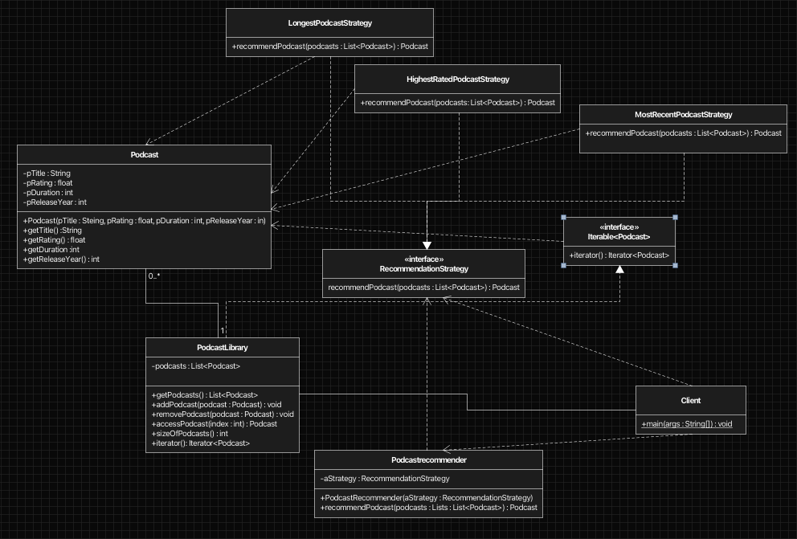

# Podcast Recommendation System

## Overview
The Podcast Recommendation System is a Java application that demonstrates Object-Oriented Programming principles and the Strategy Design Pattern.

The application allows podcasts to be stored in a library and recommended using different recommendation algorithms. Recommendation behavior can be changed without modifying the recommender itself by selecting different strategy implementations.

## Features
* Store and manage podcasts in a podcast library.
* Recommend the highest-rated podcast.
* Recommend the longest podcast.
* Recommend the most recently released podcast.
* Iterate through podcasts using Java's enhanced for-loop.
* Validate podcast information during object creation.

## Technologies Used
* Java
* Eclipse

## Concepts Demonstrated

* Object-Oriented Programming (OOP)
* Encapsulation
* Polymorphism
* Interfaces
* Strategy Design Pattern
* Dependency Injection
* Collections Framework
* Iterator and Iterable Interfaces
* Input Validation
* UML Class Diagrams
* Method Overriding

## Design Pattern

This project uses the Strategy Design Pattern.

The PodcastRecommender class delegates recommendation behavior to objects implementing the RecommendationStrategy interface. This allows recommendation algorithms to be swapped without modifying the recommender class.

### Implemented Strategies
* HighestRatedPodcastStrategy
* LongestPodcastStrategy
* MostRecentPodcastStrategy

## UML Class Diagram

The following UML diagram illustrates the relationships between classes and demonstrates the Strategy Pattern implementation.

The application can recommend podcasts according to different criteria such as highest rating, longest duration, or most recent release.

### Future Improvements

* Podcast categories
* Search and filtering functionality
* Graphical User Interface (GUI)
* Database integration
* User profiles and playlists
* Additional recommendation strategies

